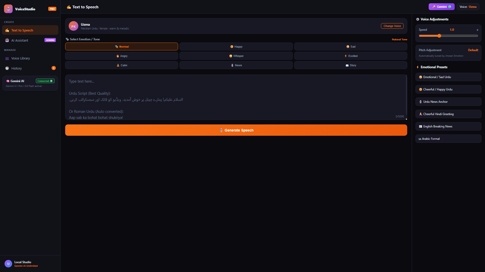

# 🎙️ VoiceStudio Pro — The 100% Free ElevenLabs Alternative

> **Ultra-realistic Neural Voice Generation · 100+ Multi-Lingual Voices · Google Gemini 3.1 AI Director · Multi-Emotion SSML Controls · Conversational AI Voice Agent**



---

## ✨ Features

- 💎 **ElevenLabs Dark Studio Interface**: Modern, sleek, responsive dark mode UI designed for creators and audio professionals.
- 🗣️ **100+ High-Quality Neural Voices**:
  - **Urdu (Pakistan & India)**: Uzma (Female), Asad (Male), Salman, Gul.
  - **Hindi (India)**: Swara (Female), Madhur (Male).
  - **English (US, UK, India, Australia)**: Rachel, Adam, Sam, Brian, Charlotte, Mia, Harry, Neerja, Prabhat.
  - **Arabic**: Zariyah, Hamed, Fatima, Salma (Saudi Arabia, UAE, Egypt).
  - **Regional Languages**: Pashto, Persian (Farsi), Bangla, Gujarati, Marathi.
- 🧠 **Google Gemini 3.1 AI Voice Director**:
  - Automatically understands Roman Urdu/Hindi prompts (e.g., *"Urdu mein larki ki awaz mein emotional poetry bolo"*).
  - Translates Roman Urdu into 100% pure, natural Urdu script (نستعلیق / عربی رسم الخط) with proper punctuation for flawless native pronunciation.
  - Automatically selects the optimal voice, pitch, and speed.
- 🎭 **Emotional SSML Expression Engine**:
  - **Normal** (Balanced)
  - **Happy / Cheerful** (Higher pitch, vibrant cadence)
  - **Sad / Emotional** (Deeper pitch, slower pacing)
  - **Angry / Intense** (Heightened pitch, aggressive tempo)
  - **Whisper / Soft** (Soft volume, intimate tone)
  - **Excited / Energetic** (Fast rate, enthusiastic pitch)
  - **Calm / Meditation** (Gentle soothing flow)
  - **News Anchor** (Professional broadcasting rhythm)
  - **Storyteller** (Dramatic narrative modulation)
- 🤖 **Conversational AI Voice Agent**:
  - Natural back-and-forth multi-turn chat in Roman Urdu, Urdu, Hindi, or English.
  - Speaks responses aloud automatically with human expression.
  - Integrated Microphone input for voice dictation (Web Speech API).
- ⚡ **100% Local & Free**:
  - Runs directly on your machine without mandatory paid subscriptions.
  - Unlimited generations saved to your local history with instant MP3 downloads.

---

## 🚀 Quick Start (Windows)

1. **Clone the repository**:
   ```bash
   git clone https://github.com/talhs999/VoiceStudio-Pro.git
   cd VoiceStudio-Pro
   ```

2. **Install dependencies**:
   ```bash
   pip install -r requirements.txt
   ```

3. **Launch the application**:
   Simply double-click:
   ```cmd
   START_VOICESTUDIO.bat
   ```
   *This starts the Flask backend on `http://localhost:5000` and opens VoiceStudio in your default browser.*

---

## 🔑 Gemini AI Setup (Optional)

VoiceStudio functions out of the box with built-in heuristic parsing. To unlock the full Gemini 3.1 AI brain:
1. Get a free API key from [Google AI Studio](https://aistudio.google.com/).
2. In VoiceStudio, click **"Gemini Key"** in the top navigation or sidebar.
3. Paste your key and click **Save**.

---

## 📂 Project Architecture

```
VoiceStudio-Pro/
├── START_VOICESTUDIO.bat      # 1-Click launcher
├── STOP_VOICESTUDIO.bat       # Clean shutdown script
├── requirements.txt           # Python dependencies
├── backend/
│   ├── app.py                 # Flask server, Gemini 3.1 integration, Edge TTS
│   ├── config.example.json    # Example configuration template
│   ├── history.json           # Generation history storage
│   └── audio_output/          # Saved MP3 recordings
└── frontend/
    └── index.html             # Single-page ElevenLabs dark studio application
```

---

## 📜 License

MIT License. Free for personal and commercial content creation.

